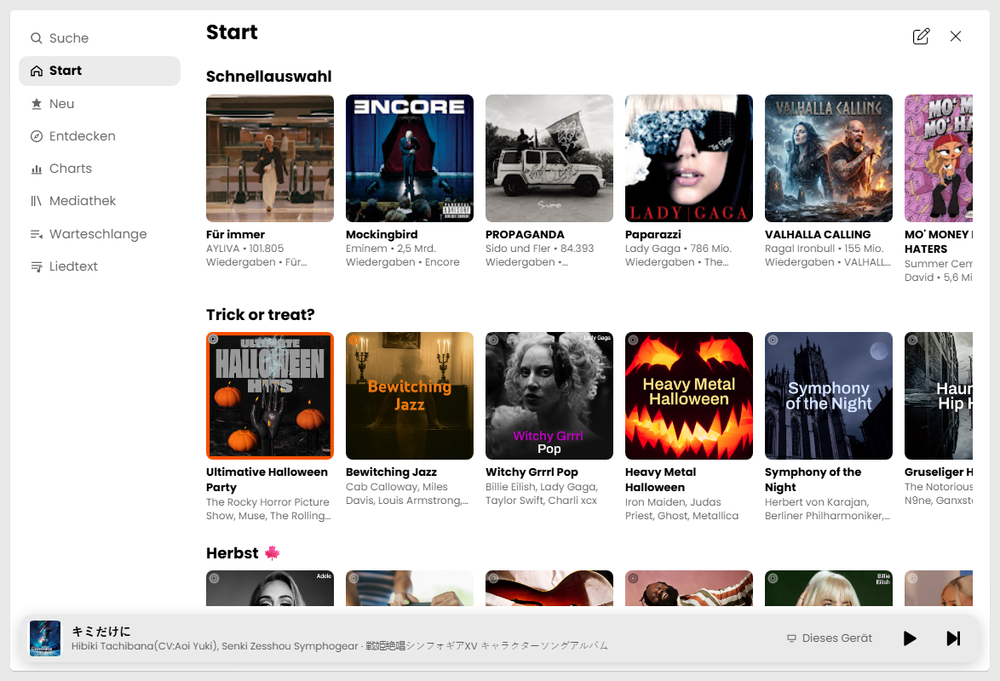
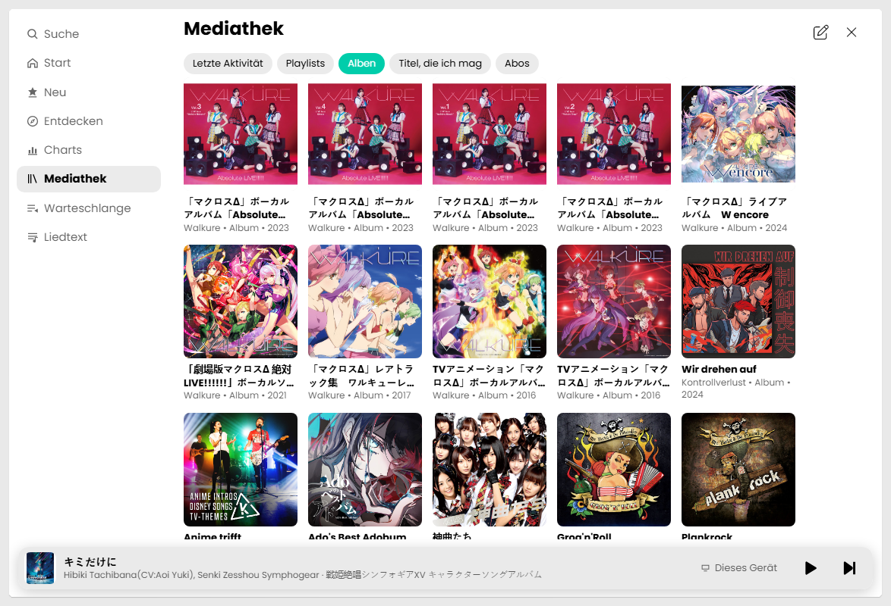
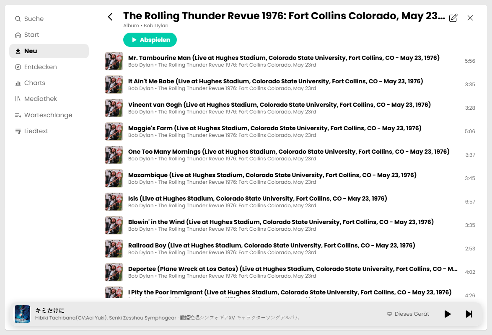
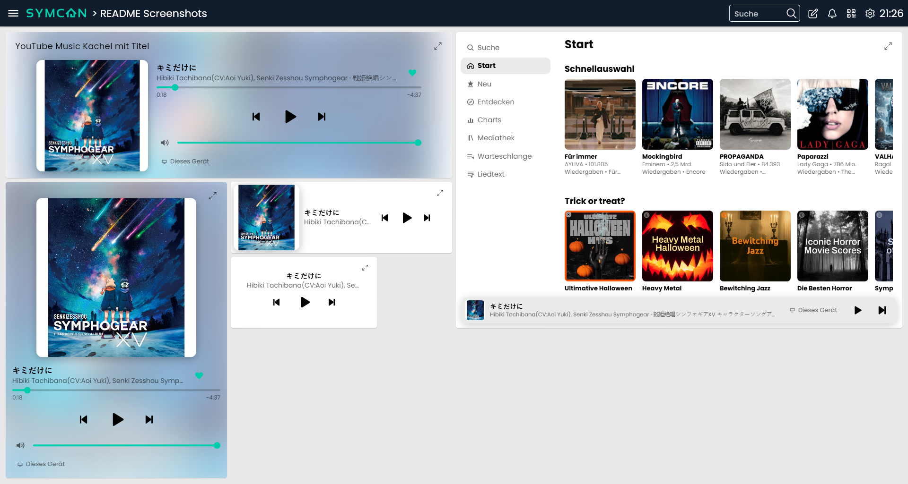
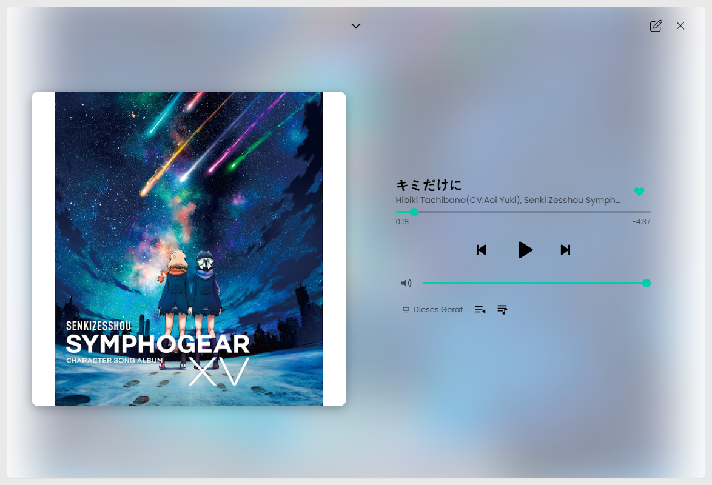
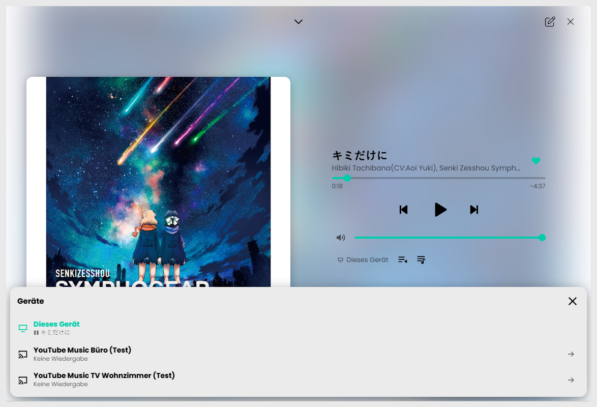

  

  

# Symcon-Modul: YouTubeMusic <!-- omit in toc -->  

> [!IMPORTANT]
> Die Anmeldung mit einem Google-Konto ist derzeit noch nicht verfügbar. Sie kommt mit der Anbindung an den OAuth-Dienst von Symcon. Bis dahin funktionieren Suche, Start, Neu, Entdecken, Charts, Liedtexte und die Wiedergabe ohne Anmeldung. Mediathek, Likes und die werbefreie Wiedergabe mit dem eigenen Konto folgen mit der Anmeldung.

   YouTube Music in der Kachel-Visualisierung von IP-Symcon: Musik suchen, stöbern und abspielen, direkt im Browser der Visualisierung oder auf Chromecast- und TV-Geräten mit YouTube Music. Skripte und Ablaufpläne steuern die Wiedergabe über Statusvariablen und `YTM_*`-Befehle.  

   Fragen, Fehler und Wünsche gerne im [Thema im Symcon-Forum](https://community.symcon.de/t/modul-kachel-youtube-music-player/144831).  

   Dieses Projekt stammt nicht von Google und wird von Google weder unterstützt noch geprüft. YouTube und YouTube Music sind Marken von Google LLC.  

## Inhaltsverzeichnis  <!-- omit in toc -->  

- [1. Funktionsumfang](#1-funktionsumfang)
  - [Die Kachel](#die-kachel)
  - [Wo die Musik spielt](#wo-die-musik-spielt)
  - [Mehrere Konten](#mehrere-konten)
  - [Vorbemerkungen](#vorbemerkungen)
    - [Zur Library](#zur-library)
    - [Zur Integration von Geräten](#zur-integration-von-geräten)
- [2. Voraussetzungen](#2-voraussetzungen)
- [3. Software-Installation](#3-software-installation)
  - [Erste Schritte](#erste-schritte)
- [4. Enthaltende Module](#4-enthaltende-module)
- [5. Anhang](#5-anhang)
  - [1. GUID der Module](#1-guid-der-module)
  - [2. Changelog](#2-changelog)
  - [3. Spenden](#3-spenden)
- [6. Lizenz](#6-lizenz)

## 1. Funktionsumfang

### Die Kachel

   Aufgebaut wie die Musik-App:  

| Bereich           | Inhalt                                                                                          |
| :---------------- | :---------------------------------------------------------------------------------------------- |
| **Suche**         | Titel, Videos, Alben, Künstler und Playlists. Ein eingefügter YouTube-Link wird direkt abgespielt |
| **Start**         | die Startseite von YouTube Music (Schnellauswahl, Mixe, Empfehlungen)                           |
| **Neu**           | neue Alben, Singles und Musikvideos                                                             |
| **Entdecken**     | Stimmungen und Genres                                                                           |
| **Charts**        | Top-Titel, Top-Videos und Top-Künstler                                                          |
| **Mediathek**     | Letzte Aktivität, Playlists, Alben, „Titel, die ich mag“ und Abos (nur mit Anmeldung)           |
| **Warteschlange** | die nächsten Titel zum laufenden Titel                                                          |
| **Liedtext**      | zum laufenden Titel, synchron mitlaufend, wenn YouTube Zeiten liefert                           |

 

   Die Kachel passt sich ihrer Größe an:  

* **Klein:** Titel und Steuerung, bei etwas mehr Platz mit Cover und Lautstärke.  
* **Mittel:** Cover, Titel, Fortschritt, Steuerung, Lautstärke und Geräteauswahl über einem Farbverlauf aus dem Cover.  
* **Groß oder maximiert:** alle Bereiche, breit mit Seitenleiste, schmal mit Reitern oben. Unten zeigt ein Mini-Player den laufenden Titel; ein Tipp darauf öffnet „Läuft gerade“ mit großem Cover, Like, Fortschritt, Lautstärke, Geräteauswahl, Warteschlange und Liedtext.  

   Bedienung:  

* Ein Titel aus einem Album oder einer Playlist spielt die ganze Liste ab diesem Titel, ein einzelner Titel startet ein Radio dazu.  
* Ein Tipp auf Künstler oder Album des laufenden Titels sucht danach.  
* Lange Listen laden beim Scrollen nach, Reihen lassen sich mit Maus oder Finger seitlich ziehen.  
* Mehrere Kacheln derselben Instanz (z. B. eine für die Warteschlange, eine für den Liedtext) merken sich ihre Ansicht jeweils selbst.  

### Wo die Musik spielt

   Jeder [YouTube Music Player](YouTube%20Music%20Player/) ist ein Wiedergabegerät, wahlweise:  

* **Kachel:** Die Musik spielt im Browser der Visualisierung. Jede Visualisierung (jedes Tablet, jeder PC) spielt dabei für sich. Das Video erscheint in einem kleinen, verschiebbaren Fenster oder auf Wunsch in der Kachel anstelle des Covers. Die Wiedergabe läuft beim Wechsel der Kategorie weiter und pausiert beim Verlassen der Visualisierung.  
* **Chrome Cast:** Die Kachel ist die Fernbedienung der YouTube-Music-App auf einem Chromecast, Nest Hub oder TV mit Google TV (über eine Instanz der Library Chrome Cast). Für Skripte gibt es hier Statusvariablen.  

 

   Über **Geräte** wählt die Kachel, welches Gerät sie steuert. Ein Tipp auf das Pfeilsymbol neben einem Gerät übergibt die laufende Wiedergabe dorthin (Titel, Liste und Position) und beendet sie hier, ähnlich wie Spotify Connect. Ein Chromecast oder TV wird dabei wieder freigegeben. Welche Geräte eine Kachel steuern darf, wird je Player eingestellt.  

### Mehrere Konten

   Eine Instanz [YouTube Music Account](YouTube%20Music%20Account/) steht für ein Konto. Es können beliebig viele Accounts angelegt werden, jeder mit eigenen Playern.  

   Beispiel: Die Tochter bekommt eine eigene Visualisierung mit einem eigenen Account (ihre Mediathek, ihre Likes, ihre Empfehlungen) und eigenen Playern für ihr Tablet und den Lautsprecher in ihrem Zimmer. Die Geräteauswahl einer Kachel zeigt immer nur die Player desselben Accounts.  

### Vorbemerkungen

#### Zur Library

   Die Library nutzt zwei Wege:  

* **Offiziell:** YouTube Data API v3 (Bewerten von Titeln) und der YouTube-IFrame-Player (Wiedergabe im Browser).  
* **Inoffiziell:** InnerTube (die Schnittstelle von music.youtube.com) für Suche, Mediathek, Charts, Warteschlange und Liedtexte sowie das Lounge-Protokoll zur Fernsteuerung der YouTube-App auf Cast- und TV-Geräten.  

> [!NOTE]
> InnerTube und Lounge sind nicht dokumentiert und können von Google jederzeit geändert werden. Dann fallen die betroffenen Funktionen aus, bis die Library angepasst ist. Fehler dieser inoffiziellen Schnittstellen erscheinen nur im Debug der Instanzen.

   Es gibt kein Herunterladen und keinen Zugriff auf Audiodaten. Die Wiedergabe erfolgt immer über den Player von YouTube bzw. die YouTube-App des Geräts.  

#### Zur Integration von Geräten

   Ohne Anmeldung arbeitet der Account anonym: Suche, Start, Neu, Entdecken, Charts, Liedtexte und die Wiedergabe funktionieren, die Inhalte sind aber nicht personalisiert. Mit Anmeldung kommen hinzu:  

* die **Mediathek** (Playlists, Alben, „Titel, die ich mag“, Abos) und persönliche Mixe,  
* **Likes** für den laufenden Titel,  
* auf Chrome-Cast- und TV-Geräten die Wiedergabe mit dem eigenen Konto, mit YouTube Premium also ohne Werbung, auch wenn am Gerät selbst niemand angemeldet ist.  

   Im Browser der Visualisierung gilt das Konto, mit dem der Browser bei YouTube angemeldet ist.  

## 2. Voraussetzungen

* IP-Symcon ab Version 8.1 mit Kachel-Visualisierung (die Kachel im Vollbild ab 9.1)  
* Internetzugang des Symcon-Servers  
* Für die Wiedergabe in der Kachel: Aufruf der Visualisierung über einen **Hostnamen** (z. B. `symcon.local` oder Symcon Connect), nicht über die IP-Adresse. Der YouTube-Player lehnt Seiten ohne Hostnamen ab (Fehler 150).  
* Für Chromecast und TV: die Library Chrome Cast (CCast) ab Version 0.51 mit einer Instanz für das Gerät  

## 3. Software-Installation

   Über den 'Module-Store' in Symcon das Modul 'YouTubeMusic' hinzufügen.  

### Erste Schritte

1. Eine Instanz **YouTube Music Account** anlegen. Ohne Anmeldung ist sie sofort aktiv.  
2. Darunter eine Instanz **YouTube Music Player** anlegen und als Ausgabe **Kachel** wählen.  
3. Den Player in eine Kategorie der Kachel-Visualisierung verlinken und die Kachel groß ziehen oder maximieren.  
4. Einen Bereich wählen (z. B. Charts) und einen Titel antippen. Der erste Start braucht einen echten Tipp in der Kachel, Browser lassen kein automatisches Abspielen zu.  
5. Optional für jeden Chromecast bzw. TV einen weiteren Player mit Ausgabe **Chrome Cast** und der passenden Chrome-Cast-Instanz anlegen. Er erscheint danach in der Geräteauswahl jeder Kachel desselben Accounts.  

> [!TIP]
> Spielt in der Kachel nichts und erscheint Fehler 150, wird die Visualisierung über eine IP-Adresse aufgerufen. Über den Hostnamen des Servers oder Symcon Connect funktioniert es.

## 4. Enthaltende Module

### [YouTube Music Account](YouTube%20Music%20Account/)  

   Die Verbindung zu einem YouTube-Konto: Anmeldung, Suche, Mediathek, Likes, Liedtexte und ein Zähler aller Anfragen. Alle Player eines Kontos hängen an ihm.  

### [YouTube Music Player](YouTube%20Music%20Player/)  

   Ein Wiedergabegerät mit der Kachel: spielt im Browser der Visualisierung oder steuert die YouTube-Music-App auf einem Chromecast bzw. TV. Bietet Statusvariablen (Chrome Cast) und `YTM_*`-Befehle zum Abspielen, Steuern, Übergeben, Suchen und Bewerten.  

## 5. Anhang

### 1. GUID der Module

|         Modul         |  Typ   |                  GUID                  |
| :-------------------: | :----: | :------------------------------------: |
| YouTube Music Account |   IO   | {B2338A56-F57D-47A5-90BD-2C7E4FE3033B} |
| YouTube Music Player  | Device | {432AD6E7-A9AC-44D5-A26E-962C77035C9D} |

### 2. Changelog

**Version 0.10:**  

> [!IMPORTANT]
> Vorabversion: Funktionsumfang und Einstellungen können sich bis zur ersten Veröffentlichung noch ändern.

**Neue Module**  

* [YouTube Music Account](YouTube%20Music%20Account/): Verbindung zu einem YouTube-Konto mit Suche, Mediathek, Likes, Liedtexten und Anfragezähler.  
* [YouTube Music Player](YouTube%20Music%20Player/): Kachel-Visualisierung mit Wiedergabe im Browser oder Steuerung von Chromecast- und TV-Geräten.  

### 3. Spenden

   Die Library ist für die nicht kommerzielle Nutzung kostenlos, Schenkungen als Unterstützung für den Autor werden hier akzeptiert:  

  

## 6. Lizenz

   Eigene Lizenz, nicht kommerziell, Weitergabe unter gleichen Bedingungen (siehe [LICENSE](LICENSE)).  
