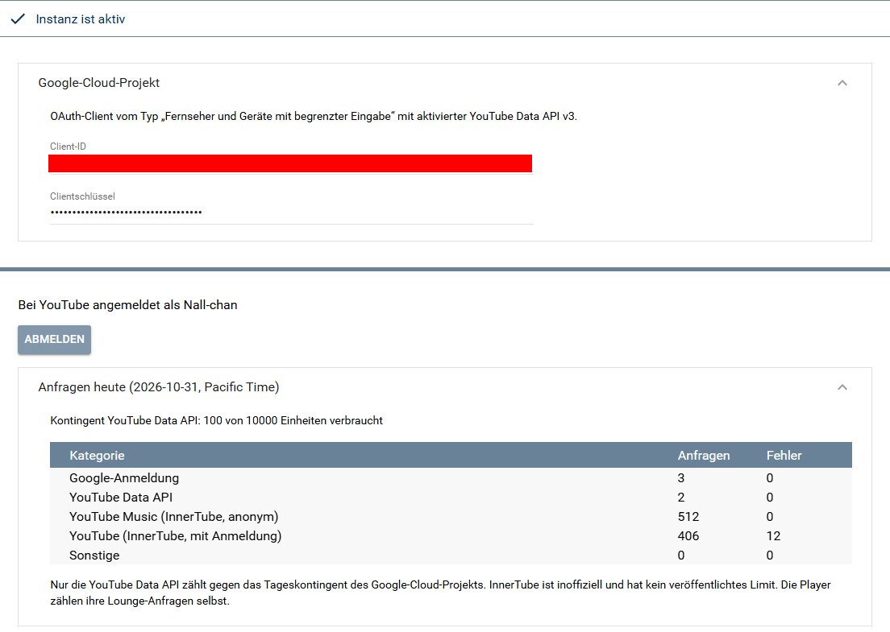

[](https://www.symcon.de/service/dokumentation/entwicklerbereich/sdk-tools/sdk-php/)
[](https://community.symcon.de/t/modul-kachel-youtube-music-player/144831)
[](https://www.symcon.de/de/service/dokumentation/installation/migrationen/v81-v90-q1-2026/)  
[](#10-lizenz)
[](https://github.com/Nall-chan/PlayerForYouTube/actions)
[](https://github.com/Nall-chan/PlayerForYouTube/actions)  
[](../README.md#3-spenden)
[](../README.md#3-spenden)

# YouTube Music Account <!-- omit in toc -->

   Gemeinsame Schnittstelle zu YouTube und YouTube Music für alle Player.  

## Dokumentation <!-- omit in toc -->

**Inhaltsverzeichnis**

- [1. Funktionsumfang](#1-funktionsumfang)
- [2. Voraussetzungen](#2-voraussetzungen)
- [3. Software-Installation](#3-software-installation)
- [4. Einrichten der Instanzen in IP-Symcon](#4-einrichten-der-instanzen-in-ip-symcon)
  - [Eigenschaften](#eigenschaften)
  - [Anmelden und Abmelden](#anmelden-und-abmelden)
- [5. Statusvariablen](#5-statusvariablen)
- [6. Visualisierung](#6-visualisierung)
  - [Kachel Visualisierung](#kachel-visualisierung)
  - [WebFront Visualisierung](#webfront-visualisierung)
- [7. PHP-Befehlsreferenz](#7-php-befehlsreferenz)
- [8. Aktionen](#8-aktionen)
- [9. Anhang](#9-anhang)
  - [1. Changelog](#1-changelog)
  - [2. Spenden](#2-spenden)
- [10. Lizenz](#10-lizenz)

## 1. Funktionsumfang

* Anmeldung mit dem eigenen Google-Konto (Device Flow), Speichern und automatisches Erneuern des Tokens.  
* Suche, Startseite, Charts, Neuheiten, Stimmungen, Mediathek, Playlists, Alben und Künstlerseiten über InnerTube (inoffiziell).  
* Warteschlange (Radio) und synchroner Liedtext zu einem Titel.  
* Bewerten von Titeln (Like/Dislike) über die YouTube Data API v3.  
* Zähler aller Anfragen je Kategorie mit Anzeige des verbrauchten Tageskontingents der Data API.  
* Ohne Anmeldung ist die Instanz aktiv (Status 102); Suche, Startseite und Charts funktionieren dann anonym, Mediathek und Likes nicht.  

## 2. Voraussetzungen

* IP-Symcon ab Version 8.1  
* Internetzugang des Symcon-Servers  
* Für die Anmeldung: Google-Cloud-Projekt mit aktivierter YouTube Data API v3 und ein OAuth-Client vom Typ **TVs und Geräte mit beschränkter Eingabe** (siehe [Haupt-README](../README.md#zur-integration-von-geräten))  

## 3. Software-Installation

Dieses Modul ist Bestandteil der [YouTubeMusic-Library](../).  

## 4. Einrichten der Instanzen in IP-Symcon

   Unter Instanz hinzufügen ist das Modul 'YouTube Music Account' (Alias 'YouTube Account') zu finden. Die Instanz hat keine übergeordnete Instanz. Die [YouTube Music Player](../YouTube%20Music%20Player/) hängen als Kinder an ihr.  

   Eine Instanz steht für ein Konto. Für weitere Konten (z. B. eine eigene Visualisierung der Tochter mit ihrer Mediathek) wird je Konto ein weiterer Account mit eigenen Playern angelegt.  

     

   Das Bild zeigt die Instanz nach der Anmeldung: Die Client-ID ist maskiert, das Clientschlüssel-Feld zeigt nur Punkte. Unten ist der Bereich `Anfragen heute` aufgeklappt.  

### Eigenschaften

|    Eigenschaft    |     Name     |  Typ   | Standardwert |                          Beschreibung                           |
| :---------------: | :----------: | :----: | :----------: | :-------------------------------------------------------------: |
|     Client ID     |   ClientId   | string |   (leer)     |       Client-ID des OAuth-Clients aus dem Google-Cloud-Projekt   |
|  Client secret    | ClientSecret | string |   (leer)     |                 Client-Secret desselben OAuth-Clients            |

```php
IPS_SetProperty(12345, 'ClientId', '1234567890-abc.apps.googleusercontent.com');
IPS_SetProperty(12345, 'ClientSecret', 'GOCSPX-…');
IPS_ApplyChanges(12345);
```

   Statuscodes: `102` aktiv, `201` Anmeldung abgelaufen (z. B. Token vom Nutzer widerrufen oder Testprojekt nach 7 Tagen). Dann erneut anmelden.  

### Anmelden und Abmelden

> [!IMPORTANT]
> Die Anmeldung für alle Nutzer kommt mit der Anbindung an den OAuth-Dienst von Symcon und ist derzeit noch nicht verfügbar. Die Felder Client-ID und Client-Secret sind eine Übergangslösung mit einem eigenen Google-Cloud-Projekt und können sich noch ändern.

1. Client-ID und Client-Secret eintragen und `Übernehmen`.  
2. `Mit Google anmelden`: Die Anmeldeseite öffnet sich, ein Popup zeigt den Code. Mit dem Google-Konto anmelden und den Code eingeben.  
3. Die Anmeldung schließt sich selbstständig ab, das Formular lädt neu.  

   `Abmelden` widerruft das Token bei Google und löscht die gespeicherten Anmeldedaten.  

> [!IMPORTANT]
> Mit einem Cloud-Projekt im Status „Testen“ läuft das Token nach 7 Tagen ab. Das Projekt dauerhaft auf „In Produktion“ stellen.

   Der Bereich `Anfragen heute` zeigt je Kategorie Anfragen und Fehler. Nur die YouTube Data API zählt gegen das Tageskontingent (10.000 Einheiten, Wechsel um 0 Uhr Pacific Time). InnerTube ist inoffiziell und hat kein veröffentlichtes Limit.  

## 5. Statusvariablen

   Die Instanz legt keine Statusvariablen an.  

## 6. Visualisierung

### Kachel Visualisierung

   Die Instanz hat keine eigene Kachel. Die Kachel liefert der [YouTube Music Player](../YouTube%20Music%20Player/).  

### WebFront Visualisierung

   Die Instanz hat keine Darstellung im WebFront.  

## 7. PHP-Befehlsreferenz

   Fehler werden als Text an den Aufrufer gemeldet, die Funktion gibt dann `false` zurück. Die Funktionen von Suche bis Bewerten stehen auch am [YouTube Music Player](../YouTube%20Music%20Player/#7-php-befehlsreferenz) zur Verfügung und gehen von dort an den Account.  

   **Video-IDs** sind die 11 Zeichen nach `v=` in einem YouTube-Link, **Playlist-IDs** der Teil nach `list=` (z. B. `PL…`, `RDCLAK…`, `LM` für „Gefällt mir“).  

```php
array|false YTM_Search(integer $InstanzID, string $Query, string $Type);
```

   Sucht in YouTube Music. `$Query` ist der Suchbegriff. `$Type` ist `song`, `video`, `album`, `artist`, `playlist` oder leer für alle. Rückgabe: `shelves` (Titel, Einträge) und `continuation`.  

```php
$Result = YTM_Search(12345, 'Daft Punk', 'artist');
```

```php
array|false YTM_Browse(integer $InstanzID, string $BrowseId, string $Params);
```

   Lädt eine Seite. `$BrowseId` z. B. `FEmusic_home` (Startseite), `FEmusic_charts`, `FEmusic_liked_playlists`, `VL<Playlist-ID>` (Playlist), `MPREb_…` (Album), `UC…` (Künstler). `$Params` sind Zusatzparameter (z. B. Stimmung/Genre), sonst leer. Persönliche Seiten brauchen die Anmeldung.  

   Rückgabe: `shelves` (je `title` und `items`), `continuation` und `client` für `YTM_BrowseMore` sowie `tabs`. Die Mediathek (`FEmusic_liked_playlists`) liefert unter `tabs` ihre Reiter (`title`, `token`, `selected`); den Inhalt eines Reiters lädt `YTM_BrowseMore` mit dessen `token`.  

```php
$Library = YTM_Browse(12345, 'FEmusic_liked_playlists', '');
$Albums = YTM_BrowseMore(12345, $Library['tabs'][2]['token'], $Library['client']);
```

```php
array|false YTM_BrowseMore(integer $InstanzID, string $Token, string $Client);
```

   Lädt die nächste Seite einer Liste. `$Token` und `$Client` (`music` oder `tv`) stammen aus `continuation` bzw. `client` des vorherigen Ergebnisses.  

```php
array|false YTM_GetQueue(integer $InstanzID, string $VideoId, string $PlaylistId);
```

   Warteschlange zu einem Titel bzw. einer Liste. Ist `$PlaylistId` leer, wird das Radio zum Titel geliefert. Mit Anmeldung personalisiert und mit Like-Status.  

```php
array|false YTM_GetLyrics(integer $InstanzID, string $VideoId);
```

   Liedtext zu einem Titel (`text`, `source`). `text` ist leer, wenn es keinen Liedtext gibt. Falls vorhanden, sind die Zeiten für den synchronen Liedtext enthalten.  

```php
bool YTM_SetRating(integer $InstanzID, string $VideoId, string $Rating);
```

   Bewertet einen Titel im Konto. `$Rating` ist `like`, `dislike` oder `none` (Bewertung entfernen). Braucht die Anmeldung, kostet 50 Einheiten des Tageskontingents.  

```php
array YTM_GetDevices(integer $InstanzID);
```

   Liste der Player an diesem Account mit `id`, `name`, `type` (0 = Kachel, 1 = Chrome Cast) und zuletzt gemeldetem `state`.  

```php
array YTM_GetRequestStatistics(integer $InstanzID);
```

   Anfragen des laufenden Tages je Kategorie (`oauth`, `dataApi`, `innerTubeMusic`, `innerTubeTv`, `other`) mit `requests`, `errors`, verbrauchten `units`, `quota` und dem Vortag (`previous`).  

```php
bool YTM_StartLogin(integer $InstanzID);
bool YTM_Logout(integer $InstanzID);
bool YTM_RefreshAccessToken(integer $InstanzID);
string|false YTM_ApiRequest(integer $InstanzID, string $Method, string $Url, string $Body);
```

   `YTM_StartLogin` liefert die Adresse der Anmeldeseite und ist für das Formular gedacht. `YTM_Logout` meldet ab. `YTM_RefreshAccessToken` erneuert das Access-Token (geschieht automatisch). `YTM_ApiRequest` sendet eine Anfrage mit Token an Google; erlaubt sind `GET`, `POST`, `PUT`, `DELETE` per `https` an `www.googleapis.com`, `youtube.googleapis.com`, `music.youtube.com` und `www.youtube.com`. Rückgabe ist JSON mit `http` und `body`.  

## 8. Aktionen

**Grundsätzlich können alle bedienbaren Statusvariablen als Ziel einer [`Aktion`](https://www.symcon.de/service/dokumentation/konzepte/automationen/ablaufplaene/aktionen/) mit `Auf Wert schalten` angesteuert werden, so dass hier keine speziellen Aktionen benutzt werden müssen.**  

   Dieses Modul hat keine Statusvariablen und damit keine Aktionen.  

## 9. Anhang

### 1. Changelog

   Siehe [Changelog der Library](../README.md#2-changelog).  

### 2. Spenden

   Die Library ist für die nicht kommerzielle Nutzung kostenlos, Schenkungen als Unterstützung für den Autor werden hier akzeptiert:  

[](https://paypal.me/Nall4chan)  

[](https://www.amazon.de/hz/wishlist/ls/YU4AI9AQT9F?ref_=wl_share)

## 10. Lizenz

   Eigene Lizenz, nicht kommerziell, Weitergabe unter gleichen Bedingungen (siehe [LICENSE](../LICENSE)).  
