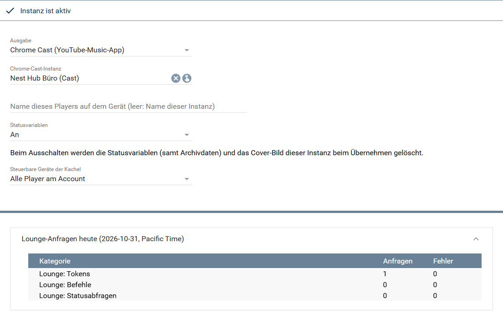
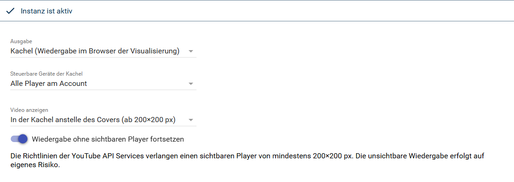
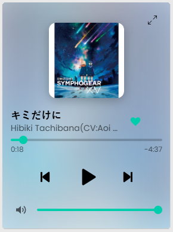
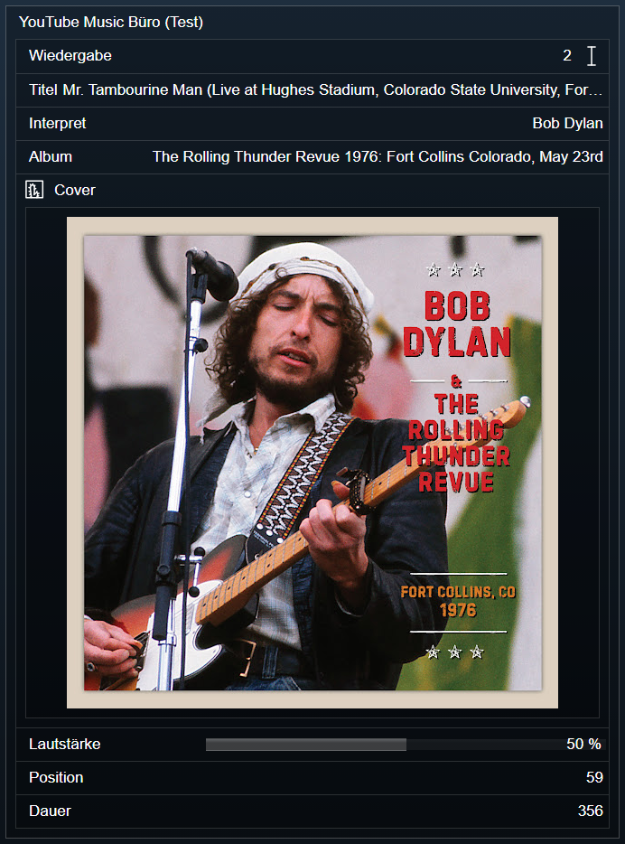

[](https://www.symcon.de/service/dokumentation/entwicklerbereich/sdk-tools/sdk-php/)
[](https://community.symcon.de/t/modul-kachel-youtube-music-player/144831)
[](https://www.symcon.de/de/service/dokumentation/installation/migrationen/v81-v90-q1-2026/)  
[](#10-lizenz)
[](https://github.com/Nall-chan/PlayerForYouTube/actions)
[](https://github.com/Nall-chan/PlayerForYouTube/actions)  
[](../README.md#3-spenden)
[](../README.md#3-spenden)

# YouTube Music Player <!-- omit in toc -->

   Wiedergabegerät mit Kachel-Visualisierung für YouTube und YouTube Music.  

## Dokumentation <!-- omit in toc -->

**Inhaltsverzeichnis**

- [1. Funktionsumfang](#1-funktionsumfang)
- [2. Voraussetzungen](#2-voraussetzungen)
- [3. Software-Installation](#3-software-installation)
- [4. Einrichten der Instanzen in IP-Symcon](#4-einrichten-der-instanzen-in-ip-symcon)
  - [Eigenschaften](#eigenschaften)
  - [Gerätetyp Kachel](#gerätetyp-kachel)
  - [Gerätetyp Chrome Cast](#gerätetyp-chrome-cast)
- [5. Statusvariablen](#5-statusvariablen)
- [6. Visualisierung](#6-visualisierung)
  - [Kachel Visualisierung](#kachel-visualisierung)
  - [WebFront Visualisierung](#webfront-visualisierung)
- [7. PHP-Befehlsreferenz](#7-php-befehlsreferenz)
- [8. Aktionen](#8-aktionen)
- [9. Anhang](#9-anhang)
  - [1. Changelog](#1-changelog)
  - [2. Spenden](#2-spenden)
- [10. Lizenz](#10-lizenz)

## 1. Funktionsumfang

* Kachel im Design eines Musikplayers in drei Größenstufen (Mini, Kompakt, Voll). Die Voll-Ansicht zeigt Suche, Start, Neu, Entdecken, Charts, Mediathek, Warteschlange, Liedtext und „Läuft gerade“.  
* Liken und Disliken des laufenden Titels (mit Anmeldung am [Account](../YouTube%20Music%20Account/)).  
* Zwei Gerätetypen:  
  * **Kachel:** Die Wiedergabe läuft im Browser der Visualisierung. Jede Visualisierung spielt unabhängig.  
  * **Chrome Cast:** Fernsteuerung der YouTube-Music-App auf einem Chromecast oder TV, mit Statusvariablen.  
* Geräteauswahl in der Kachel: Wiedergabe auf einem anderen Player des Accounts starten oder die laufende Wiedergabe übergeben.  
* Synchroner Liedtext, soweit YouTube Zeiten liefert.  
* Abspielen von YouTube-Links, Titeln und Listen per PHP-Befehl.  

## 2. Voraussetzungen

* IP-Symcon ab Version 8.1, für die Vollbild-Kachel ab 9.1  
* Eine Instanz [YouTube Music Account](../YouTube%20Music%20Account/) als übergeordnete Instanz  
* Kachel-Wiedergabe: Aufruf der Visualisierung über einen **Hostnamen**, nicht über die IP-Adresse (sonst meldet der YouTube-Player Fehler 150)  
* Chrome Cast: eine Chrome-Cast-Instanz (CCast) für das Gerät  

> [!NOTE]
> Die Symcon-Apps haben kein Hauptfenster für den Browser-Player und stoppen die Wiedergabe beim Kategoriewechsel. Über eine IP-Adresse gilt zusätzlich Fehler 150, über Symcon Connect funktioniert es. Die Hinweiszeile bietet bei Fehler 150/101 „In YouTube Music öffnen“ an (ungetestet).

## 3. Software-Installation

Dieses Modul ist Bestandteil der [YouTubeMusic-Library](../).  

## 4. Einrichten der Instanzen in IP-Symcon

   Unter Instanz hinzufügen ist das Modul 'YouTube Music Player' (Alias 'YouTube Player') zu finden. Als übergeordnete Instanz wird ein [YouTube Music Account](../YouTube%20Music%20Account/) gewählt.  

   Das Formular zeigt je nach `Ausgabe` andere Felder. Beim Gerätetyp Chrome Cast (im Bild die Instanz „Büro“ mit Nest Hub, unten der aufgeklappte Bereich `Lounge-Anfragen heute`):  

     

   Beim Gerätetyp Kachel entfallen die Chrome-Cast-Felder, dafür erscheinen die Einstellungen zum Video:  

     

### Eigenschaften

|                   Eigenschaft                   |       Name       |  Typ   | Standardwert |                                                                                       Beschreibung                                                                                        |
| :---------------------------------------------: | :--------------: | :----: | :----------: | :---------------------------------------------------------------------------------------------------------------------------------------------------------------------------------------: |
|                     Output                      |    DeviceType    |  int   |      1       |                                                                          `0` = Kachel, `1` = Chrome Cast                                                                          |
|              Chrome Cast instance               |   CastInstance   |  int   |      0       |                                                           Instanz-ID der Chrome-Cast-Instanz (nur Chrome Cast, Pflicht)                                                           |
|                 Name of this player             |    PlayerName    | string |   (leer)     |                                     Name der Fernbedienung auf dem Gerät (nur Chrome Cast). Leer = Name der Instanz                                     |
|                Status variables                 | EnableVariables  |  int   |      0       |                                          `0` = An, `2` = Aus (nur Chrome Cast). Aus löscht die Variablen samt Archivdaten und das Cover                                          |
|          Devices the tile can control          |   ControlMode    |  int   |      0       |                                  `0` = alle Player des Accounts, `1` = nur dieses Gerät, `2` = ausgewählte Player (nur Richtung Kachel → Gerät)                                  |
|           Players the tile can control          |  ControlDevices  | string |     `[]`     |                                                       JSON-Liste mit `InstanceID` der Player bei `ControlMode` = 2                                                       |
|                  Show video                     |   VideoDisplay   |  int   |      0       |                       `0` = schwebendes, verschiebbares Fenster, `1` = in der Kachel anstelle des Covers (ab 200×200 px). Nur Kachel                       |
| Continue playback without a visible player      |  HiddenPlayback  |  bool  |    false     |                    Parkt den Player außerhalb des Fensters, die Wiedergabe läuft weiter. Nur Kachel, auf eigenes Risiko (siehe Hinweis)                    |

```php
IPS_SetProperty(12345, 'DeviceType', 1);
IPS_SetProperty(12345, 'CastInstance', 23456);
IPS_SetProperty(12345, 'EnableVariables', 0);
IPS_ApplyChanges(12345);
```

   Statuscodes: `102` aktiv, `201` nicht mit einem YouTube Music Account verbunden, `202` keine Chrome-Cast-Instanz gewählt.  

   Wird ein Kachel-Player auf Chrome Cast umgestellt, beendet er beim Übernehmen die Wiedergabe in allen Browsern.  

> [!WARNING]
> Die YouTube API Services Policies verlangen einen sichtbaren Player von mindestens 200×200 px. Die Option `HiddenPlayback` verstößt dagegen und erfolgt auf eigenes Risiko.

### Gerätetyp Kachel

   Die Wiedergabe läuft in einem Browser-Player im Hauptfenster der Visualisierung, je Instanz und Browser einer, der alle Kacheln dieser Instanz bedient. Es gibt keine Statusvariablen und keinen gemeinsamen Gerätezustand (`YTM_GetDeviceState` meldet einen Fehler). PHP-Befehle zur Wiedergabe gehen an alle Browser-Player der Instanz.  

   Das Video erscheint wahlweise in einem schwebenden Fenster (an der Titelleiste verschiebbar, Lage je Browser gemerkt) oder in der Kachel anstelle des Covers.  

   Die Wiedergabe läuft beim Kategoriewechsel weiter (Mini-Player sichtbar ab 200×200 px). Beim Verlassen der Visualisierung pausiert sie.  

> [!NOTE]
> Klicks im YouTube-Player (Titel, Teilen, „Weitere Videos“, Logo) öffnen youtube.com in einem neuen Tab. Das lässt sich technisch nicht abfangen.

### Gerätetyp Chrome Cast

   Das Modul verbindet sich über das Lounge-Protokoll als Fernbedienung mit der YouTube-Music-App auf dem Gerät. Im Formular wird die Chrome-Cast-Instanz des Geräts gewählt. Ist die App im Leerlauf beendet, wird sie beim Abspielen gestartet.  

   Mit Anmeldung am Account verbindet sich die Fernbedienung mit dem Konto, das Gerät spielt dann mit Konto (Premium, keine Werbung). Ohne Anmeldung bleibt die Sitzung anonym und das Gerät spielt ohne Konto.  

   Nach `Übernehmen` oder einem Neustart verbindet sich die Instanz still neu, sofern auf dem Gerät gerade YouTube Music läuft. Sie startet dabei keine App.  

> [!NOTE]
> Stumm schaltet die Instanz über Chrome Cast (`CCAST_SetMute`), da die YouTube-App den Lounge-Befehl nicht umsetzt.

## 5. Statusvariablen

   Nur beim Gerätetyp Chrome Cast und mit `Status variables` = An:  

|    Name     |    Typ    | Darstellung  | Aktion |                       Beschreibung                       |
| :---------: | :-------: | :----------: | :----: | :------------------------------------------------------: |
| Wiedergabe  |  integer  |   Playback   |   ja   |          Zustand und Bedienung (Play, Pause, Stopp, Zurück, Weiter)          |
|    Titel    |  string   |    Wert      |  nein  |                      Laufender Titel                     |
|  Interpret  |  string   |    Wert      |  nein  |                    Interpret des Titels                  |
|    Album    |  string   |    Wert      |  nein  |                      Album des Titels                    |
| Lautstärke  |  integer  | Schieberegler|   ja   |                 0 bis 100 %, Lautstärke der App                |
|  Position   |  integer  |   Dauer      |  nein  |                Aktuelle Position im Titel                |
|    Dauer    |  integer  |   Dauer      |  nein  |                      Länge des Titels                    |

   Zusätzlich legt die Instanz ein Cover-Medienobjekt an. `Status variables` = Aus löscht Variablen, Archivdaten und Cover beim Übernehmen.  

## 6. Visualisierung

### Kachel Visualisierung

   Die Instanz liefert eine eigene HTML-Kachel (Visualisierungstyp „Vollbild“ ab Symcon 9.1, sonst Kachel). Die Farben folgen der Visualisierung (Akzent-, Inhalts- und Kartenfarbe), die Schrift ist Poppins. Titel und Maximieren der Kachel gehören dem Nutzer: Das Modul setzt sie nicht.  

     

   Das Bild zeigt die Kachel in der Stufe Kompakt (ca. 2 × 3 Felder) mit Cover, Titel, Fortschritt, Steuerung und Lautstärke.  

   **Größenstufen** (nach der Größe der Kachel):  

* **Mini** (unter 200 px Höhe): Titel und Steuerung, bei genug Breite mit Cover und Lautstärke.  
* **Kompakt:** Cover, Titel, Fortschritt, Steuerung, Lautstärke und Geräteauswahl über einem Farbverlauf aus dem Cover. Breite Kacheln zeigen Cover und Steuerung mittig, große Kacheln vergrößern die Steuerung mit. Hat die Kachel einen Titel, füllt der Farbverlauf auch den Titelbereich.  
* **Voll** (ab ca. 640 × 420 px oder maximiert): Bereiche als Seitenleiste (breit) bzw. Reiter (schmal), unten der Mini-Player. Ein Tipp auf den Mini-Player öffnet „Läuft gerade“ (Cover links, Steuerung rechts bzw. darunter); der Pfeil oben schließt es wieder.  

   **Bereiche:**  

* **Suche:** Filter für Titel, Videos, Alben, Künstler und Playlists. Ein eingefügter Link oder eine ID von YouTube bzw. YouTube Music wird direkt abgespielt.  
* **Start, Neu, Entdecken, Charts:** Inhalte von YouTube Music. Alben und Playlists öffnen eine Seite mit „Abspielen“, Künstler eine Seite mit „Radio“.  
* **Mediathek** (nur mit Anmeldung am [Account](../YouTube%20Music%20Account/)): Reiter Letzte Aktivität, Playlists, Alben, „Titel, die ich mag“ und Abos.  
* **Warteschlange** und **Liedtext** zum laufenden Titel. Der Liedtext läuft synchron mit, wenn YouTube Zeiten liefert.  

   **Bedienung:**  

* Ein Titel aus einem Album, einer Playlist oder der Warteschlange spielt die Liste ab diesem Titel, ein einzelner Titel (z. B. aus der Suche) startet ein Radio dazu.  
* Ein Tipp auf Künstler oder Album des laufenden Titels (Mini-Player, „Läuft gerade“) öffnet die Suche danach.  
* Listen laden beim Scrollen nach. Reihen lassen sich per Touch oder mit der Maus seitlich ziehen.  
* Jede Kachel merkt sich ihren Bereich, den gewählten Reiter bzw. Filter und ob „Läuft gerade“ offen ist, auch mehrere Kacheln derselben Instanz und die maximierte Kachel getrennt (je Browser-Tab).  
* Das Herz liked den laufenden Titel bzw. nimmt das Like zurück (mit Anmeldung).  

   **Geräte:** Das Geräte-Symbol öffnet die Geräteliste mit diesem Browser („Dieses Gerät“) und den anderen Playern des Accounts. Ein Tipp auf ein Gerät macht es zum gesteuerten Gerät, der Pfeil daneben übergibt die laufende Wiedergabe (Titel, Liste, Position) dorthin und beendet sie hier (ein Chrome-Cast-Gerät wird dabei freigegeben, dieser Browser pausiert). Welche Geräte zur Wahl stehen, regelt `Devices the tile can control`; das Modul prüft jeden Befehl der Kachel.  

   Lange Listen (Mediathek, Mixe, Radio) löst das Modul für den Browser-Player in bis zu 100 Titel auf und lädt am Ende des Fensters die nächsten nach. Zurück geht dabei nicht in das vorige Fenster.  

### WebFront Visualisierung

   Die Kachel steht im klassischen WebFront nicht zur Verfügung. Beim Gerätetyp Chrome Cast werden die Statusvariablen angezeigt:  

     

   `Wiedergabe` erscheint im klassischen WebFront nur als Wert (hier `2` = Play) ohne Tasten für Play, Pause und Weiter, Position und Dauer als Sekunden. Font-Awesome-Symbole zeigt das klassische WebFront nicht an.  

## 7. PHP-Befehlsreferenz

   Fehler werden als Text an den Aufrufer gemeldet, die Funktion gibt dann `false` zurück. **Video-IDs** sind die 11 Zeichen nach `v=` in einem YouTube-Link, **Playlist-IDs** der Teil nach `list=`.  

```php
bool YTM_PlayURL(integer $InstanzID, string $URL);
```

   Spielt einen Link von YouTube oder YouTube Music ab (`watch?v=…&list=…`, `playlist?list=…`, `youtu.be/…` oder reine IDs).  

```php
YTM_PlayURL(12345, 'https://music.youtube.com/watch?v=dQw4w9WgXcQ');
```

```php
bool YTM_PlayVideo(integer $InstanzID, string $VideoId, string $PlaylistId);
bool YTM_PlayVideoAt(integer $InstanzID, string $VideoId, string $PlaylistId, float $Seconds);
```

   Spielt einen Titel bzw. eine Liste. Ist `$VideoId` leer, startet die Liste beim ersten Eintrag. Ist `$PlaylistId` leer, spielt nur der Titel (danach Vorschläge des Dienstes). `YTM_PlayVideoAt` startet bei `$Seconds` (≥ 0).  

```php
bool YTM_Play(integer $InstanzID);
bool YTM_Pause(integer $InstanzID);
bool YTM_Stop(integer $InstanzID);
bool YTM_Next(integer $InstanzID);
bool YTM_Previous(integer $InstanzID);
bool YTM_Seek(integer $InstanzID, float $Seconds);
bool YTM_SetVolume(integer $InstanzID, integer $Volume);
bool YTM_SetMute(integer $InstanzID, bool $Mute);
```

   Steuern die Wiedergabe. `$Seconds` ist die Position ab Titelanfang (≥ 0), `$Volume` liegt zwischen 0 und 100. `YTM_Stop` beendet die Wiedergabe und meldet die Fernbedienung beim Gerätetyp Chrome Cast vom Gerät ab, damit es wieder frei ist (die App geht danach in den Leerlauf). Beim Gerätetyp Kachel gehen die Befehle an alle Browser-Player der Instanz, `YTM_Stop` pausiert dort.  

```php
bool YTM_TransferTo(integer $InstanzID, integer $TargetID);
```

   Übergibt die laufende Wiedergabe (Titel, Liste, Position) an einen anderen Player desselben Accounts und beendet sie auf diesem Gerät wie `YTM_Stop`. `$TargetID` ist die Instanz-ID des Ziel-Players.  

```php
array|false YTM_GetDeviceState(integer $InstanzID);
array YTM_GetDevices(integer $InstanzID);
array YTM_GetRequestStatistics(integer $InstanzID);
```

   `YTM_GetDeviceState` liefert nur beim Gerätetyp Chrome Cast `videoId`, `listId`, `state` (-1 unbekannt, 0 beendet, 1 spielt, 2 Pause, 3 puffert, 5 geladen), `position`, `duration`, `volume`, `muted`, `hasPrevious`, `hasNext`, `shuffle`, `loop` und `connected`. `YTM_GetDevices` listet die Player des Accounts. `YTM_GetRequestStatistics` zählt die Lounge-Anfragen des Tages (`loungeToken`, `loungeCommand`, `loungePoll`).  

```php
array|false YTM_Search(integer $InstanzID, string $Query, string $Type);
array|false YTM_Browse(integer $InstanzID, string $BrowseId, string $Params);
array|false YTM_BrowseMore(integer $InstanzID, string $Token, string $Client);
array|false YTM_GetQueue(integer $InstanzID, string $VideoId, string $PlaylistId);
array|false YTM_GetLyrics(integer $InstanzID, string $VideoId);
bool YTM_SetRating(integer $InstanzID, string $VideoId, string $Rating);
```

   Reichen die Anfrage an den Account weiter. Parameter und Rückgaben stehen in der [Befehlsreferenz des Accounts](../YouTube%20Music%20Account/README.md#7-php-befehlsreferenz).  

## 8. Aktionen

**Grundsätzlich können alle bedienbaren Statusvariablen als Ziel einer [`Aktion`](https://www.symcon.de/service/dokumentation/konzepte/automationen/ablaufplaene/aktionen/) mit `Auf Wert schalten` angesteuert werden, so dass hier keine speziellen Aktionen benutzt werden müssen.**  

   Bedienbar sind `Wiedergabe` und `Lautstärke` (nur Chrome Cast).  

## 9. Anhang

### 1. Changelog

   Siehe [Changelog der Library](../README.md#2-changelog).  

### 2. Spenden

   Die Library ist für die nicht kommerzielle Nutzung kostenlos, Schenkungen als Unterstützung für den Autor werden hier akzeptiert:  

[](https://paypal.me/Nall4chan)  

[](https://www.amazon.de/hz/wishlist/ls/YU4AI9AQT9F?ref_=wl_share)

## 10. Lizenz

   Eigene Lizenz, nicht kommerziell, Weitergabe unter gleichen Bedingungen (siehe [LICENSE](../LICENSE)).  
